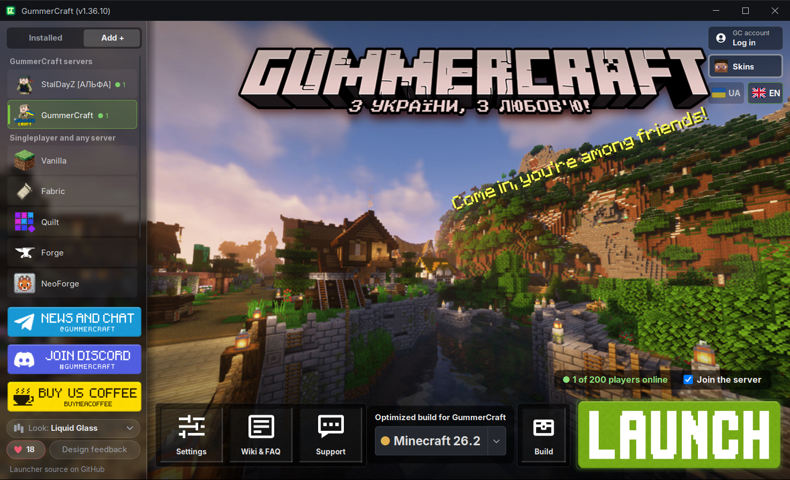
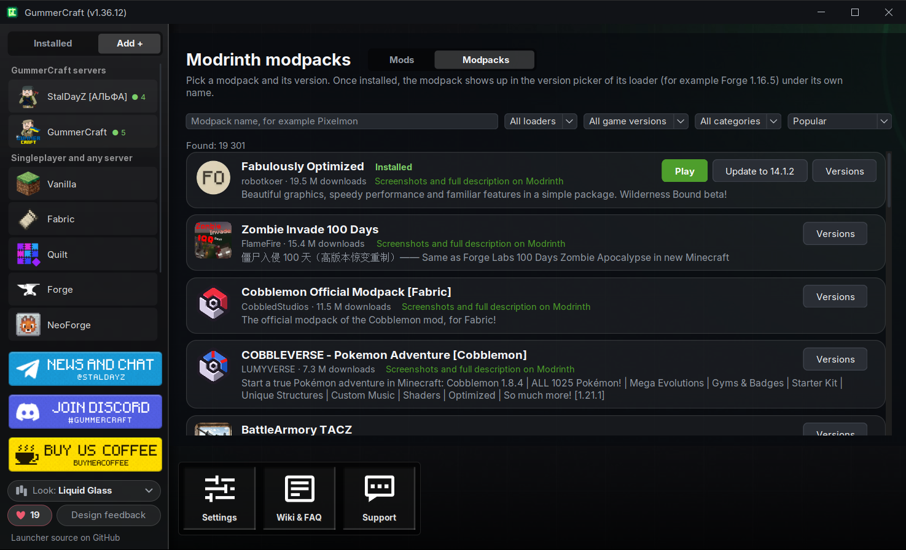
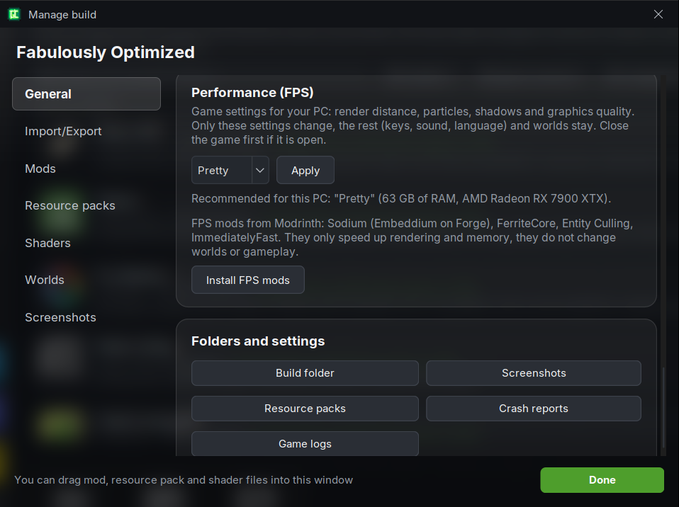
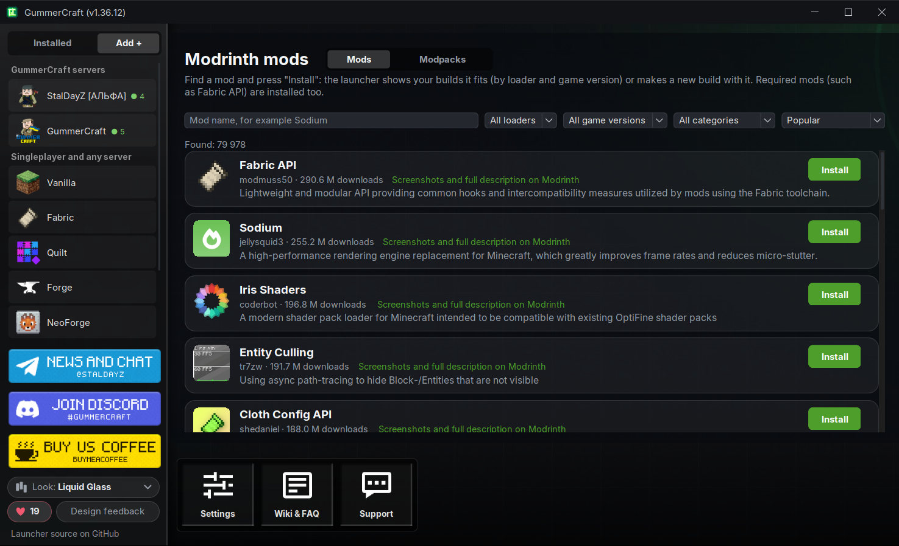
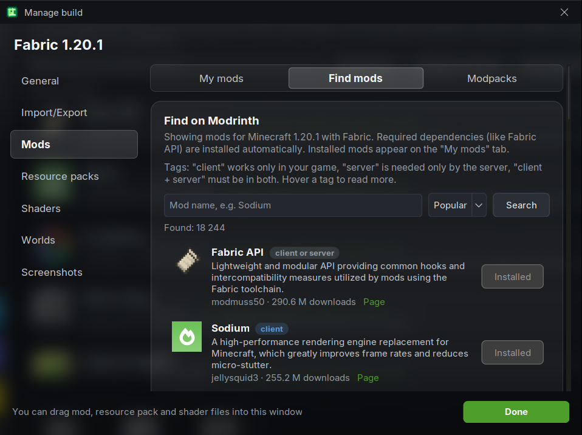

<div align="center">


</div>

# GummerCraft Launcher

<div align="center">

**English** · **[Українська](README.uk.md)**

[](https://gummercraft.fun/en/launcher)
[](LICENSE.txt)
[](https://gummercraft.fun/en/launcher)
[](https://gummercraft.fun/en/launcher)

</div>

A free, open-source (LGPL-3.0) Minecraft launcher from Ukraine, made by the [GummerCraft](https://gummercraft.fun/en/launcher) project. No ads. Windows, Linux, Steam Deck and macOS. It installs any Minecraft version, Fabric, Quilt, Forge and NeoForge, Modrinth modpacks and mods, and the packs of our StalDayZ and GummerCraft servers. The interface is in English and Ukrainian.

**[Download for Windows](https://launch.gummercraft.fun/install/GummerCraft.exe)** (one file, Java included) · [portable zip](https://launch.gummercraft.fun/install/GummerCraft-portable.zip) · [Linux and Steam Deck](https://launch.gummercraft.fun/install/linux/GummerCraft-Linux.desktop) · [jar for macOS and Linux](https://launch.gummercraft.fun/install/jar) · [launcher page](https://gummercraft.fun/en/launcher) ([Steam Deck](https://gummercraft.fun/en/steamdeck), [Linux](https://gummercraft.fun/en/linux), [Mac](https://gummercraft.fun/en/mac))

| Main window (Liquid Glass) | Modrinth modpacks | Build window: FPS presets |
|---|---|---|
|  |  |  |

| Modrinth mods | Build window: find mods |
|---|---|
|  |  |

## Features

**Game versions and mod loaders**
- Every Minecraft release from Mojang, snapshots and pre-releases of the next version, and a "museum" of the oldest versions: Classic, Infdev, Alpha, Beta, all the way down to rd-132211.
- Fabric (1.14+), Quilt, Forge (1.7.10+) and NeoForge (1.20.2+): the launcher installs the loader itself and prepares Forge and NeoForge the way the official installer does. The loader version can be changed.
- The right Java (8, 11, 16, 17, 21 or 25, Eclipse Temurin builds) is installed automatically for each game version. Settings show when a newer Java is available, with "Update" and "Roll back" buttons.
- Any number of installs of the same version, one-click copies of builds, and a custom name, icon and background for each build.

**Modrinth, mods and modpacks**
- One-click Modrinth modpacks with search and filters. Modpack updates with the authors' changelog and a way back to the previous version.
- Search and install mods, resource packs and shaders right in the Build window. Required dependencies are installed automatically, every file is checked against the Modrinth hash, and each mod shows whether it is client-side, server-side or needed on both.
- Update your mods one by one or with "Update all". The old version of a mod is kept for 30 days: if the game starts crashing after an update, the mod goes back with one button.
- "Share build": a `.mrpack` or `.zip` file with all the mods that both our launcher and Prism can open.
- Import builds from Prism Launcher, PolyMC, ATLauncher, CurseForge, the old Modrinth App, TLauncher, SKlauncher and the official Minecraft launcher (MultiMC and any other launcher: pick the folder by hand). Mods, settings, resource packs and shaders are moved over, worlds if you want.

**Helper: when something goes wrong**
- **Before launch** it checks the mods: a mod for the wrong loader or game version, the same mod twice, incompatible pairs, missing dependencies. It offers to find the right version on Modrinth, download the dependency or disable what is extra. Damaged or missing game files are downloaded again on their own.
- **After a crash** it reads the game log and explains the cause in plain words: the mod that killed the game, not enough memory, the graphics driver, the wrong Java or its arguments, a broken mod config, a damaged world, Cyrillic letters in the path, a file blocked by the antivirus. Next to it are buttons that fix it: disable the mod, download the missing one, reset the config, bring back the previous mod version.
- Support right from the launcher: a request becomes a chat with our team, the log and system details are attached automatically (if you tick the box).

**Performance**
- FPS presets "Weak PC", "Balanced" and "Pretty", with a recommendation for your PC's memory and graphics card and FPS mods from Modrinth (Sodium or Embeddium, FerriteCore, Entity Culling, ImmediatelyFast). "Restore game settings" undoes a preset.
- On PCs with two graphics cards the game runs on the discrete one by default, and a build can pick another. Memory and Java per build, with a recommendation by mod count and a tuned garbage collector for Minecraft 1.18+.
- Free disk space check before downloading. The first game install comes as a few large archives from our CDN that resume after a broken connection.

**Accounts and interface**
- Microsoft sign-in or an offline account with any nickname. Installed builds also start without internet.
- An optional GummerCraft account: skins for our servers and a player page with statistics.
- Three looks: Liquid Glass, Classic and Library. English or Ukrainian, switched with a flag without a restart.

**Platforms**
- Windows 7-11: a single `GummerCraft.exe` with Java inside (17 on Windows 10 and 11, 8 on Windows 7 and 8.1), no administrator rights needed. A portable zip is also available for Windows 10 and 11.
- Linux x86_64 and Steam Deck: the `GummerCraft-Linux.desktop` file installs the launcher with its own Java, without a terminal or root rights, and adds it to the applications menu. On SteamOS it is also added to the Steam library with GummerCraft artwork (cover, header, logo; the player's own artwork is left alone), so it starts from Game Mode, together with a gamepad layout that works both in the launcher and in the game (button table in [tools/linux](tools/linux/README.md)). Instructions and script: [tools/linux](tools/linux).
- macOS: a jar file, needs Java 8 or newer installed.
- On Linux and macOS the launcher turns on a light mode without blur and animations.
- The launcher updates itself: the new version is downloaded over HTTPS and checked against SHA-256.

## StalDayZ and GummerCraft

<div align="center">


</div>

**[StalDayZ](https://staldayz.gummercraft.fun/)** is our Minecraft server inspired by S.T.A.L.K.E.R. and DayZ: the Exclusion Zone, looting, anomalies and artifacts, emissions, radiation, mutants, quests, trading and player bases. The launcher also has GummerCraft packs for different Minecraft versions.

You can join right from the launcher: pick the pack, press "Launch", and the launcher downloads all the mods it needs and keeps them updated. The server's online count is shown next to the pack, and the "Straight to server" box starts the game and joins the server at once.

## What's new in 1.36.12

- **Progress in worlds of builds from other launchers.** An offline account now plays with the same ID (UUID) as SKlauncher, TLauncher, other launchers and servers. In a build imported from another launcher, quests, mod data and access to your own claims in its worlds come back. Worlds you already played in our launcher are recognised and keep working as before.
- **Modrinth mods and game files download much faster.** The launcher no longer opens a new connection for each of thousands of small files, which is most noticeable with an antivirus that inspects HTTPS.
- **Import from other launchers opens at once** and looks for builds in the background. Before, on PCs with big builds the window could fail to open and the launcher hung.
- **Game language.** On a non-Ukrainian system GummerCraft packs open in English on the first launch, and vanilla no longer picks up Ukrainian from other builds.
- **No more cut-off labels** with Windows scaling at 125-150% in all three looks. The "Build" button is now "Build settings", build names in Library take two lines, and the FAQ button opens the launcher page in your language.

**Every change in every version: [CHANGELOG.md](CHANGELOG.md#english-changelog).**

## Security and transparency

- What the launcher does on the network (every address and what is sent there), what it stores on the computer, and known limitations: [SECURITY.md](SECURITY.md).
- No ads. There are anonymous statistics: a random install ID (not derived from anything, no nickname or account), "game started" events with the pack name, "pack download" and a few others, each described in SECURITY.md. The word `off` in the `stats-id.txt` file in the launcher folder turns all of it off.
- Anyone can check the official build on our CDN: see [Verify the official build](#verify-the-official-build).
- SHA-256 of every release file is published in [Releases](https://github.com/gummerBurt/GummerCraftLauncher/releases). To check a downloaded file: `Get-FileHash GummerCraft.exe` in PowerShell or `sha256sum GummerCraft.exe` on Linux and macOS.

## Origin and license

This project is a fork of **SKCraft Launcher** (Albert Pham / sk89q and contributors) and is distributed under the same terms, the **GNU LGPL v3**, full text in [LICENSE.txt](LICENSE.txt); third-party contributions are also covered by the SKCraft BSD license, [licenses/BSD-contributors.txt](licenses/BSD-contributors.txt) (until 21.11.2026 it was at the end of LICENSE.txt). The original project's history is in the [SKCraft repository](https://github.com/SKCraft/Launcher).

Changes by the GummerCraft team (2021-2026): a new FlatLaf interface (`launcher-flat`, three looks), Ukrainian and English localisation, our own pack and Java runtime manifests, the Vanilla, Fabric, Quilt, Forge and NeoForge sections, Modrinth integration, build and mod management, the launch and crash helper, in-launcher support, import from other launchers, the Linux and Steam Deck installer. Full history in [CHANGELOG.md](CHANGELOG.md). Files added by the team live in the `com.gummer.*` packages and carry a `Copyright (C) GummerCraft` header; changed SKCraft files carry both copyrights.

## What the launcher does on your computer

- All files live **in one folder** `GummerCraft` in the folder Java treats as documents: `Documents\GummerCraft` on Windows, `~/GummerCraft` on Linux (the Linux and Steam Deck installer puts it there too). The path is stored in `GummerCraft/bootstrap.yml` and can be changed. Portable mode: a `portable.txt` file next to the launcher.
- Folder contents: `launcher/` (launcher jar), `runtime/` (portable Java, Eclipse Temurin builds), `assets/`, `libraries/`, `versions/` (Minecraft files), `instances/` (builds), `config.json` (settings), `accounts.dat` (saved accounts), since 1.32 `support.json` (support requests from the launcher), `launcher-ui.json` (tab, last build, "Straight to server"), `logs/launcher.log` (launcher log for the last three runs), `news-cache.json` and `vanilla_versions.json` (copies of the news and the Mojang version list), `stats-id.txt` (anonymous random install ID for counting players, contains nothing about you; `off` in the file turns it off, details in [SECURITY.md](SECURITY.md)). Vanilla versions go to `instances/vanilla-<version>`. Since 1.33 loader sections go to `instances/fabric-<version>`, `quilt-<version>`, `forge-<version>`, `neoforge-<version>` (the chosen loader version is in `fabric-loader.txt` and similar files in the pack folder), version lists are kept in `fabric_games.json`, `fabric_loaders.json`, `quilt_games.json`, `quilt_loaders.json`, `forge_versions.xml`, `forge_promotions.json`, `neoforge_versions.xml`, official Forge and NeoForge installers in `loaders/`. The GummerCraft account token and nickname (if the player signed in) are in `launcher-ui.json`, the password is stored nowhere. Since 1.32 `launcher/ui-scale.txt` may appear: a reduced interface scale if the launcher window does not fit the screen with Windows scaling (deleting the file breaks nothing).
- Since 1.32 new players get a single `GummerCraft.exe` with bundled Java (Eclipse Temurin JRE 17 on Windows 10+, JRE 8 on Windows 7/8.1). On first run it spends a few seconds unpacking the launcher and Java into `%LOCALAPPDATA%\GummerCraft\app` (no administrator rights), then opens the launcher. It creates no shortcuts, no "Programs and Features" entry and no registry changes; to remove it, delete that folder or, since 1.36.3, press "Delete the launcher and all builds" in the launcher settings. The point below is about the launcher itself.
- The launcher **does not write to the registry**, with one exception: the graphics card choice for a build (since 1.36.3; Build window, shown only on PCs with two graphics cards: "Let the system decide", "name (built-in)", "name (discrete)"). Since 1.36.11 the discrete card is the default: before every launch the launcher reads the list of graphics cards again and, if there are two (built-in and discrete), writes one value to `HKCU\Software\Microsoft\DirectX\UserGpuPreferences`: the name is the path to the Java the launcher installed, the data is `GpuPreference=1;` ("Power saving", built-in) or `GpuPreference=2;` ("High performance", discrete). This is exactly what the Windows "Graphics settings" page writes, and the value shows up there too. System Java and choices already made by the player in Windows are left alone; going back to "Let the system decide", deleting builds or ending up with one graphics card removes the value. Every step goes to the launcher log, and the list of written values is in `gpu-prefs.txt` in its folder. On Linux the discrete card only adds PRIME variables (`DRI_PRIME` or NVIDIA PRIME offload) to that one launch; macOS has no choice. Apart from that the launcher only reads the keys of installed Java to find it and, since 1.36, graphics card names (for the FPS preset recommendation and this choice; the names are not sent anywhere). It **does not add itself to autostart**, creates no services, scheduled tasks or shortcuts, and does not change files outside its folder.
- Since 1.36.3 the settings ("Advanced", "Deletion") have "Delete all builds" and "Delete the launcher and all builds". The second button removes its data folder, `%LOCALAPPDATA%\GummerCraft\app` and `bootstrap.yml` in Documents. Only what the launcher created is deleted, by a list of names: other files in the data folder stay.
- The only process it starts is the game itself.

Network connections, accounts and known limitations in detail: [SECURITY.md](SECURITY.md) (in Ukrainian).

## Building

You need **JDK 8** (building with another Java version stops with an error).

1. Copy `gradle.properties.example` to `gradle.properties` (the file is in `.gitignore`).
2. Set `microsoftClientId` in it: the ID of your own Azure app for Microsoft sign-in ([register an app](https://learn.microsoft.com/entra/identity-platform/quickstart-register-app), type "Personal Microsoft accounts", redirect `http://localhost`; Microsoft requires a separate approval for access to the Minecraft API). Without it the build stops with an error. The official GummerCraft ID is not part of the repository.
3. If `JAVA_HOME` does not point to JDK 8, set `org.gradle.java.home` in the same file.

```bash
./gradlew clean build
```

Or `build.bat` (Windows) / `build.sh` (Linux, macOS).

Output goes to `<module>/build/libs`. The bootstrapper exe wrapper (Launch4j):

```bash
./gradlew clean build createAllExecutables
```

The result is `launcher-bootstrap/build/launch4j/Gummer_Craft_launcher.exe`. Official releases are not yet signed with a developer certificate (code signing is in progress), so Windows SmartScreen may warn on first run. When signing arrives, the signing keys will not be in the repository.

## Verify the official build

The official launcher on our CDN is built from this same code. Anyone can check it:

```bash
./gradlew clean build
python tools/verify-cdn.py
```

The script (Python 3 only, no third-party packages) takes the URL and SHA-256 of the current version from `cdn.gummer.cc/launcher/install/release.json`, downloads the official jar, checks the hash and compares its contents with your build file by file. Only `launcher.properties` should differ: the Microsoft app ID (not in the repository) and build data (`commit`, `branch`). The official jar contains the commit of this repository it was built from; if your build is from another commit, the script tells you which `git checkout` to do. The hash of the whole jar never matches, because zip stores file dates, so the contents are compared.

## Modules

| Module | Purpose |
|---|---|
| `launcher-bootstrap` | bootstrapper (exe/jar): finds the working folder, downloads and updates the launcher jar |
| `launcher` | core: accounts, pack installation, game launch |
| `launcher-flat` | GummerCraft interface (FlatLaf) |
| `launcher-shared` | code shared by the bootstrapper and the launcher |
| `launcher-builder` | tool that builds pack manifests for the CDN |
| `creator-tools` | graphical pack editor (from SKCraft) |
| `launcher-fancy` | old SKCraft interface, disabled in `settings.gradle` |

## Third-party code

Besides the dependencies Gradle pulls in (FlatLaf, Guava, Jackson and others, each under its own license), the repository contains files copied from other projects; their original copyright and license headers are kept in the files:

| Files | Source | License |
|---|---|---|
| `launcher/.../util/FlatClientProperties.java`, `FlatSystemProperties.java` | [FlatLaf](https://github.com/JFormDesigner/FlatLaf), FormDev Software GmbH | Apache 2.0 ([licenses/Apache-2.0.txt](licenses/Apache-2.0.txt)) |
| `launcher-flat/src/main/resources/com/gummer/launcher/fonts/Inter-*.ttf` | [Inter](https://github.com/rsms/inter) 4.0, The Inter Project Authors (from `flatlaf-fonts-inter`, converted from OTF to TrueType by `tools/inter-otf2ttf.py`, since 1.36.6) | SIL Open Font License 1.1 ([Inter-LICENSE.txt](launcher-flat/src/main/resources/com/gummer/launcher/fonts/Inter-LICENSE.txt)) |
| `launcher/.../popup/GraphicsUtilities.java`, `ShadowRenderer.java` | [SwingX](https://github.com/ebourg/swingx), Sun Microsystems / Romain Guy | LGPL 2.1+ (GraphicsUtilities also BSD) |
| `launcher-shared/.../tls/extra-roots.pem` | root certificates from Eclipse Temurin `cacerts` (Mozilla CA program) | public CA certificates |

## Developer notes

- Launcher translations: `launcher/src/main/resources/com/gummer/launcher/lang/Launcher_en_us.properties` and `Launcher_uk_ua.properties`; bootstrapper: `launcher-bootstrap/src/main/resources/com/skcraft/launcher/lang/Bootstrap.properties`.
- The main window in three looks: `launcher-flat/src/main/java/com/gummer/launcher/dialog/LauncherFrameFlat.java` (Liquid Glass), `LauncherFrameFlat2.java` (Classic), `LauncherFrameFlat3.java` (Library); pack background and logo: `FlatBackgroundPanel*.java`; colors and shapes of each look: `look/LookTheme.java`; the Build window: `dialog/InstanceManageDialog.java`. Icons and formats: `launcher/src/main/resources/com/skcraft/launcher`.
- Helper: pre-launch check in `launcher/.../manage/PreLaunchCheck.java`, crash analysis in `launcher/.../crash/CrashAnalyzer.java`; Modrinth in `launcher/.../manage/ModrinthBrowse.java` and the `modrinth` package.
- Window background: `launcher/src/main/resources/com/skcraft/launcher/ui/frame/bg.jpg` (1276x718). A pack's own background is `bg_<pack name>.jpg` next to it (name from the manifest, lowercase, e.g. `bg_staldayz.jpg`, 1276x718, drawn centered), its own logo is `logo_<pack name>.png` (PNG with transparency, fitted without stretching into the area of the standard 724x180 logo.png). They show when the pack is selected in the list (`FlatBackgroundPanel.showPack`). Background and logo offsets (in pixels) and custom button URLs: `frame_<pack name>.properties` next to them: `background.x/y`, `logo.x/y`, `wiki.url`, `telegram.url`, `discord.url`. Telegram/Discord button images with a channel name: `ui/button/telegram_<language>_<pack name>.png` (and `discord_...`).
- CDN, news and self-update URLs: `launcher/src/main/resources/com/skcraft/launcher/launcher.properties` and `launcher-bootstrap/src/main/resources/com/skcraft/launcher/bootstrap.properties`.
- The interface font is Inter (bundled, see "Third-party code"); an offline account nickname is 3-16 characters.
- Java runtime debugging: `launcher/src/main/java/com/skcraft/launcher/update/Updater.java`.
