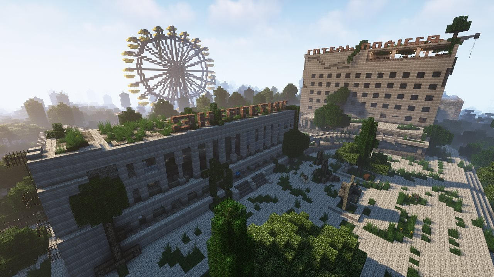

<div align="center">


</div>

# GummerCraft Launcher

Лаунчер Minecraft для серверів [GummerCraft](https://gummercraft.fun): встановлює та оновлює збірки модів і запускає гру з акаунтом Microsoft.

**[Завантажити лаунчер для Windows](https://launch.gummercraft.fun/install/exe)** · [jar для Linux і macOS](https://launch.gummercraft.fun/install/jar) · [сайт GummerCraft](https://gummercraft.fun)

*Minecraft launcher for the GummerCraft servers. A fork of [SKCraft Launcher](https://github.com/SKCraft/Launcher), licensed under LGPL v3. English summary at the bottom.*

## StalDayZ

<div align="center">



</div>

**[StalDayZ](https://staldayz.gummercraft.fun/)** - наш сервер за мотивами S.T.A.L.K.E.R. і DayZ у Minecraft: Зона відчуження, лутінг, аномалії й артефакти, викиди, радіація, мутанти, квести, торгівля та бази гравців.

Зайти на StalDayZ можна прямо з цього лаунчера: обираєш у списку збірку **StalDayZ**, натискаєш «Грати», а всі потрібні моди лаунчер завантажить і оновлюватиме сам. Крім StalDayZ, у лаунчері є збірки Main для різних версій Minecraft.

## Що нового в 1.30

- Фон і логотип вікна лаунчера міняються разом із вибраною збіркою, з плавним переходом: у StalDayZ свій фон і логотип S.T.A.L.DAYZ, у решти - звичні.
- Кнопки «Вікі та FAQ» і «Новини та чат» для StalDayZ ведуть на вікі й Telegram-канал StalDayZ.
- Лаунчер пам'ятає останню вибрану збірку й одразу відкривається з нею та її оформленням.
- Оновлення лаунчера ставляться самі, без питань: при запуску лаунчер завантажує нову версію (з перевіркою SHA-256) і перезапускається.

## Що нового в 1.29

Разом із відкриттям коду ми провели аудит лаунчера і виправили знайдене:

- **Увімкнено повну перевірку HTTPS-сертифікатів.** Раніше її було вимкнено як обхідне рішення для старих Windows і Java, яким бракувало нових кореневих сертифікатів. Через це в незахищених мережах (наприклад, публічний Wi-Fi) з'єднання лаунчера теоретично можна було перехопити. Тепер кожне з'єднання перевіряється повністю, а для старих Java лаунчер додає кілька офіційних кореневих сертифікатів до системних (див. `TrustedTls`).
- **Лаунчер і його оновлення завантажуються тільки по HTTPS і звіряються з контрольною сумою SHA-256**, опублікованою в `release.json`.
- **Exe одразу запускає найновішу версію:** при кожному старті він звіряє встановлену версію з опублікованою і, якщо вийшла новіша, ставить її до запуску. Без інтернету запускається встановлена.
- **Лог консолі відправляється по HTTPS** (лише після натискання кнопки «Завантажити лог»).
- **Бібліотека інтерфейсу FlatLaf більше не розпаковує DLL у тимчасову папку Windows** - файл лежить у папці лаунчера.
- **Прибрано невикористаний код телеметрії та ідентифікатор `uuid` з налаштувань.** Лаунчер не збирає й не відправляє даних про комп'ютер.
- **Офіційний ID застосунку Microsoft винесено з коду** в налаштування збірки.

Що лаунчер робить і з якими серверами з'єднується - у [SECURITY.md](SECURITY.md).

## Походження та ліцензія

Проєкт є форком **SKCraft Launcher** (Albert Pham / sk89q та контриб'ютори) і розповсюджується на тих самих умовах - **GNU LGPL v3**, повний текст у [LICENSE.txt](LICENSE.txt). Історія оригінального проєкту - в [репозиторії SKCraft](https://github.com/SKCraft/Launcher).

Зміни команди GummerCraft (2021–2025): новий інтерфейс на FlatLaf (`launcher-flat`), українська локалізація, власні маніфести збірок і Java-рантаймів, сповіщення, офлайн-скіни, перевірка оновлень. Файли, додані командою, лежать у пакетах `com.gummer.*` і мають заголовок `Copyright (C) GummerCraft`; змінені файли SKCraft мають обидва копірайти.

## Що лаунчер робить на комп'ютері

- Усі файли - **в одній папці**: `Документи\GummerCraft` (Windows) або `~/.gummercraft` / `$XDG_DATA_HOME/GummerCraft` (Linux, macOS). Шлях зберігається в `bootstrap.yml` і його можна змінити. Портативний режим - файл `portable.txt` поруч із лаунчером.
- Вміст папки: `launcher/` (jar лаунчера), `runtime/` (портативна Java - збірки Eclipse Temurin), `assets/`, `libraries/`, `versions/` (файли Minecraft), `instances/` (збірки), `config.json` (налаштування), `accounts.dat` (збережені акаунти).
- Лаунчер **не пише в реєстр** (лише читає ключі встановленої Java, щоб її знайти), **не додає себе в автозапуск**, не створює служб, задач планувальника чи ярликів і не змінює файли поза своєю папкою.
- Єдиний процес, який він запускає, - сама гра.

Детально про мережеві з'єднання, акаунти та відомі обмеження - у [SECURITY.md](SECURITY.md).

## Збірка

Потрібен **JDK 8** (збірка з іншою версією Java зупиниться з помилкою).

1. Скопіюйте `gradle.properties.example` у `gradle.properties` (файл у `.gitignore`).
2. Впишіть у нього `microsoftClientId` - ID власного застосунку Azure для входу через Microsoft ([реєстрація застосунку](https://learn.microsoft.com/entra/identity-platform/quickstart-register-app), тип «Personal Microsoft accounts», redirect `http://localhost`; для доступу до API Minecraft Microsoft вимагає окремо подати застосунок на схвалення). Без цього збірка зупиниться з помилкою. Офіційний ID GummerCraft у репозиторій не входить.
3. Якщо `JAVA_HOME` вказує не на JDK 8, пропишіть там же `org.gradle.java.home`.

```bash
./gradlew clean build
```

Або `build.bat` (Windows) / `build.sh` (Linux, macOS).

Готові файли - у `<модуль>/build/libs`. Exe-обгортка бутстрапера (Launch4j):

```bash
./gradlew clean build createAllExecutables
```

Результат - `launcher-bootstrap/build/launch4j/Gummer_Craft_launcher.exe`. Офіційні релізи команда підписує власним сертифікатом; ключі підпису не входять у репозиторій.

## Модулі

| Модуль | Призначення |
|---|---|
| `launcher-bootstrap` | бутстрапер (exe/jar): знаходить робочу папку, завантажує й оновлює jar лаунчера |
| `launcher` | ядро: акаунти, встановлення збірок, запуск гри |
| `launcher-flat` | інтерфейс GummerCraft (FlatLaf) |
| `launcher-shared` | спільний код бутстрапера й лаунчера |
| `launcher-builder` | утиліта збирання маніфестів збірок для CDN |
| `creator-tools` | графічний редактор збірок (з SKCraft) |
| `launcher-fancy` | старий інтерфейс SKCraft, вимкнений у `settings.gradle` |

## Сторонній код

Окрім залежностей, які підтягує Gradle (FlatLaf, Guava, Jackson тощо - кожна під своєю ліцензією), у репозиторії є скопійовані файли з інших проєктів; їхні оригінальні шапки з копірайтом і ліцензією збережені у файлах:

| Файли | Джерело | Ліцензія |
|---|---|---|
| `launcher/.../util/FlatClientProperties.java`, `FlatSystemProperties.java` | [FlatLaf](https://github.com/JFormDesigner/FlatLaf), FormDev Software GmbH | Apache 2.0 ([licenses/Apache-2.0.txt](licenses/Apache-2.0.txt)) |
| `launcher/.../popup/GraphicsUtilities.java`, `ShadowRenderer.java` | [SwingX](https://github.com/ebourg/swingx), Sun Microsystems / Romain Guy | LGPL 2.1+ (GraphicsUtilities - також BSD) |
| `launcher-shared/.../tls/extra-roots.pem` | кореневі сертифікати з `cacerts` Eclipse Temurin (програма CA Mozilla) | публічні сертифікати CA |

## Нотатки для розробників

- Переклади лаунчера: `launcher/src/main/resources/com/gummer/launcher/lang/Launcher_uk_ua.properties` і `Launcher_en_us.properties`; бутстрапера - `launcher-bootstrap/src/main/resources/com/skcraft/launcher/lang/Bootstrap.properties`.
- Вікно та форми: `launcher-flat/src/main/java/com/gummer/launcher/dialog/LauncherFrameFlat.java`; іконки та формати - `launcher/src/main/resources/com/skcraft/launcher`.
- Фон вікна: `launcher/src/main/resources/com/skcraft/launcher/ui/frame/bg.jpg` (1276x718). Власний фон збірки - `bg_<назва збірки>.jpg` поруч (назва з маніфесту, малими літерами, наприклад `bg_staldayz.jpg`, 1276x718, малюється по центру), власний логотип - `logo_<назва збірки>.png` (PNG з прозорістю, вписується без розтягування в зону стандартного logo.png 724x180). Показуються, коли збірку вибрано в списку (`FlatBackgroundPanel.showPack`). Зсуви фону й логотипа збірки (у пікселях) і власні адреси кнопок - `frame_<назва збірки>.properties` поруч: `background.x/y`, `logo.x/y`, `wiki.url`, `telegram.url`, `discord.url`. Картинки кнопок Telegram/Discord зі своєю назвою каналу - `ui/button/telegram_<мова>_<назва збірки>.png` (і `discord_...`).
- Адреси CDN, новин і самооновлення: `launcher/src/main/resources/com/skcraft/launcher/launcher.properties` та `launcher-bootstrap/src/main/resources/com/skcraft/launcher/bootstrap.properties`.
- Кольори: темний `#181818`, світлий `#F2F2F2`; іконки - [boxicons](https://boxicons.com); кнопки бічної панелі 200×48; нікнейм 3–16 символів.
- Налагодження Java-рантаймів: `launcher/src/main/java/com/skcraft/launcher/update/Updater.java`.

---

## English summary

GummerCraft Launcher installs and updates modpacks for the GummerCraft Minecraft servers and launches the game with a Microsoft account. It is a fork of SKCraft Launcher and is licensed under the **GNU LGPL v3** (see [LICENSE.txt](LICENSE.txt)); upstream history lives in the [SKCraft repository](https://github.com/SKCraft/Launcher).

**1.29 (open-source release):** full HTTPS certificate validation (it used to be disabled as a workaround for outdated Java/Windows root stores, which made the launcher's connections interceptable on untrusted networks; outdated JREs now get a few official root CAs added on top of the system store), launcher downloads over HTTPS only and verified against the SHA-256 published in `release.json`, the exe starts the newest published version right away, log upload over HTTPS, FlatLaf's native DLL no longer extracted to `%TEMP%`, unused telemetry code and the `uuid` setting removed, official Microsoft app id moved out of the source.

Everything lives in one folder (`Documents\GummerCraft` on Windows). The launcher does not write to the registry, add autostart entries, services or scheduled tasks, or touch files outside that folder. Network endpoints, account handling and known limitations are listed in [SECURITY.md](SECURITY.md).

Build with JDK 8: copy `gradle.properties.example` to `gradle.properties`, set `microsoftClientId` to your own Azure app id (the official GummerCraft id is not part of the repository), then run `./gradlew clean build` (add `createAllExecutables` for the Windows exe).
