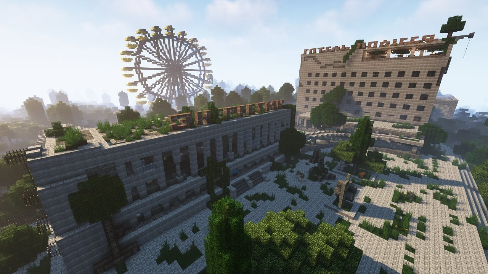

<div align="center">


</div>

# GummerCraft Launcher

Безкоштовний лаунчер Minecraft з відкритим кодом від українського проєкту [GummerCraft](https://gummercraft.fun). Ставить будь-яку версію Minecraft, Fabric, Quilt, Forge і NeoForge, модпаки та моди з Modrinth, а також збірки наших серверів StalDayZ і GummerCraft. Без реклами, українською та англійською.

**[Завантажити для Windows](https://launch.gummercraft.fun/install/GummerCraft.exe)** (один файл, Java вже всередині) · [портативний zip](https://launch.gummercraft.fun/install/GummerCraft-portable.zip) · [Linux і Steam Deck](https://launch.gummercraft.fun/install/linux/GummerCraft-Linux.desktop) · [jar для macOS і Linux](https://launch.gummercraft.fun/install/jar) · [сторінка лаунчера](https://gummercraft.fun/launcher)

*Free, open-source Minecraft launcher by the Ukrainian GummerCraft project. A fork of [SKCraft Launcher](https://github.com/SKCraft/Launcher), licensed under LGPL v3. English summary at the bottom.*

## Можливості

**Версії гри та завантажувачі**
- Усі релізи Minecraft від Mojang, снапшоти та пре-релізи наступної версії, а також «музей» найстаріших версій: Classic, Infdev, Alpha, Beta аж до rd-132211.
- Fabric (з 1.14), Quilt, Forge (з 1.7.10) і NeoForge (з 1.20.2): лаунчер сам ставить завантажувач, Forge і NeoForge готує сам, як офіційний установник. Версію завантажувача можна змінити.
- Потрібну Java (8, 11, 16, 17, 21 або 25, збірки Eclipse Temurin) лаунчер ставить сам під кожну версію гри. У налаштуваннях видно, чи є новіша Java, з кнопками «Оновити» та «Відкатити».
- Скільки завгодно установок однієї версії, копії збірок в один клік, своя назва, іконка та фон у кожної збірки.

**Modrinth, моди та модпаки**
- Модпаки Modrinth одним кліком, з пошуком і фільтрами. Оновлення модпаків зі списком змін від авторів і поверненням на попередню версію.
- Пошук і встановлення модів, ресурспаків і шейдерів прямо у вікні «Збірка». Потрібні залежності ставляться самі, кожен файл звіряється з хешем Modrinth, біля мода видно, чи він клієнтський, серверний чи потрібен і там, і там.
- Оновлення своїх модів по одному або кнопкою «Оновити все». Стара версія мода зберігається 30 днів: якщо після оновлення гра почала вилітати, мод повертається однією кнопкою.
- «Поділитися збіркою»: файл `.mrpack` або `.zip` з усіма модами, який відкриють і наш лаунчер, і Prism.
- Імпорт збірок з Prism Launcher, PolyMC, ATLauncher, CurseForge, старого Modrinth App, TLauncher, SKlauncher та офіційного лаунчера Minecraft (MultiMC і будь-який інший лаунчер: тека вручну). Моди, налаштування, ресурспаки та шейдери переносяться, світи за бажанням.

**Помічник: коли щось пішло не так**
- **Перед запуском** перевіряє моди: мод не під той завантажувач чи не під ту версію гри, той самий мод двічі, несумісні пари, брак залежностей. Пропонує знайти на Modrinth правильну версію, докачати залежність або вимкнути зайве. Пошкоджені чи відсутні файли гри докачує сам.
- **Після вильоту** розбирає журнал гри і пояснює причину звичайними словами: мод, що вбив гру, брак пам'яті, драйвер відеокарти, не та Java чи її параметри, зламаний конфіг мода, пошкоджений світ, кирилиця в шляху, файл, заблокований антивірусом. Поруч кнопки виправлення: вимкнути мод, докачати потрібний, скинути конфіг, повернути попередню версію мода.
- Підтримка прямо з лаунчера: звернення стає чатом з нашою командою, лог і дані системи додаються самі (за галочкою).

**Продуктивність**
- Пресети ФПС «Слабкий ПК», «Збалансовано», «Красиво» з порадою під пам'ять і відеокарту ПК та модами для ФПС з Modrinth (Sodium або Embeddium, FerriteCore, Entity Culling, ImmediatelyFast). Кнопка «Повернути налаштування гри» скасовує пресет.
- Вибір відеокарти для збірки на ПК з двома відеокартами (вбудована чи дискретна).
- Перевірка місця на диску перед завантаженням. Перша установка гри кількома великими архівами з нашого CDN, що докачуються після обриву.

**Акаунти та інтерфейс**
- Вхід через Microsoft або локальний акаунт з будь-яким ніком. Встановлені збірки запускаються і без інтернету.
- Необов'язковий акаунт GummerCraft: скіни для наших серверів і кабінет зі статистикою гравця.
- Три вигляди: Liquid Glass, Класика та Бібліотека. Мова UA або EN перемикається прапорцем без перезапуску.

**Платформи**
- Windows 7-11: один `GummerCraft.exe` з Java всередині (17 на Windows 10 і 11, 8 на Windows 7 і 8.1), без прав адміністратора. Для Windows 10 і 11 є ще портативний zip.
- Linux x86_64 і Steam Deck: файл `GummerCraft-Linux.desktop` ставить лаунчер з власною Java без терміналу і прав root, додає його в меню програм, а на SteamOS ще і в бібліотеку Steam з обкладинками GummerCraft (кавер, шапка, логотип; свої обкладинки гравця не чіпає), щоб запускати з ігрового режиму. Інструкція і скрипт: [tools/linux](tools/linux).
- macOS: jar-файл, потрібна встановлена Java 8 або новіша.
- На Linux і macOS лаунчер сам вмикає полегшений режим без розмиття та анімацій.
- Лаунчер оновлюється сам: нова версія качається по HTTPS і звіряється з SHA-256.

## StalDayZ і GummerCraft

<div align="center">



</div>

**[StalDayZ](https://staldayz.gummercraft.fun/)** - наш сервер за мотивами S.T.A.L.K.E.R. і DayZ у Minecraft: Зона відчуження, лутінг, аномалії та артефакти, викиди, радіація, мутанти, квести, торгівля та бази гравців. Також у лаунчері є збірки GummerCraft для різних версій Minecraft.

Зайти на сервер можна прямо з лаунчера: вибираєш збірку, натискаєш «Запуск», а всі потрібні моди лаунчер завантажить і оновлюватиме сам. Біля збірки видно онлайн сервера, а галочка «Одразу на сервер» запускає гру одразу з входом на сервер.

## Що нового в 1.36.7

- **Експорт Vanilla:** встановлену ванільну збірку тепер можна зберегти в `.mrpack` (у файлі лише версія гри, за бажанням ресурспаки). Раніше вкладка «Імпорт/Експорт» писала, що збірка не встановлена, хоч вона давно стояла.
- Виправлено: у Liquid Glass напис «UA» на перемикачі мови впирався в праву рамку. Прапорець і текст тепер стоять по центру з однаковими відступами.
- Підказки лаунчера більше не просять «натиснути Грати» там, де кнопка зветься «Запуск»: замість цього нейтральне «запусти збірку».
- **Steam Deck:** установка для Linux і Steam Deck тепер сама ставить обкладинки GummerCraft у бібліотеку Steam (кавер, широка плитка, шапка і логотип). Свої обкладинки гравця не перезаписуються. Хто вже встановив лаунчер, може ще раз запустити той самий файл `GummerCraft-Linux.desktop`, збірки і світи лишаться.
- Опис лаунчера (README) переписано під поточний стан, а всі зміни версій перенесено в окремий файл CHANGELOG.md.

**Усі зміни всіх версій: [CHANGELOG.md](CHANGELOG.md).**

## Безпека та прозорість

- Що лаунчер робить у мережі (кожна адреса і що туди йде), що зберігає на комп'ютері та відомі обмеження: [SECURITY.md](SECURITY.md).
- Реклами немає. Є анонімна статистика: випадковий ID установки (ні з чого не виводиться, без ніка і акаунта), події «гру запущено» з назвою збірки, «завантаження збірки» та кілька інших, кожна описана в SECURITY.md. Слово `off` у файлі `stats-id.txt` у теці лаунчера вимикає все це.
- Офіційну збірку на CDN можна перевірити самому: дивись [«Перевірка офіційної збірки»](#перевірка-офіційної-збірки).

## Походження та ліцензія

Проєкт є форком **SKCraft Launcher** (Albert Pham / sk89q та контриб'ютори) і розповсюджується на тих самих умовах - **GNU LGPL v3**, повний текст у [LICENSE.txt](LICENSE.txt). Історія оригінального проєкту - в [репозиторії SKCraft](https://github.com/SKCraft/Launcher).

Зміни команди GummerCraft (2021-2026): новий інтерфейс на FlatLaf (`launcher-flat`, три вигляди), українська та англійська локалізація, власні маніфести збірок і Java-рантаймів, розділи Vanilla, Fabric, Quilt, Forge, NeoForge, інтеграція з Modrinth, керування збірками і модами, помічник при запуску і вильоті, підтримка в лаунчері, імпорт з інших лаунчерів, установка на Linux і Steam Deck. Повна історія в [CHANGELOG.md](CHANGELOG.md). Файли, додані командою, лежать у пакетах `com.gummer.*` і мають заголовок `Copyright (C) GummerCraft`; змінені файли SKCraft мають обидва копірайти.

## Що лаунчер робить на комп'ютері

- Усі файли - **в одній папці** `GummerCraft` у теці, яку Java вважає документами: `Документи\GummerCraft` на Windows, `~/GummerCraft` на Linux (там же ставить і установка для Linux та Steam Deck). Шлях зберігається в `GummerCraft/bootstrap.yml` і його можна змінити. Портативний режим - файл `portable.txt` поруч із лаунчером.
- Вміст папки: `launcher/` (jar лаунчера), `runtime/` (портативна Java - збірки Eclipse Temurin), `assets/`, `libraries/`, `versions/` (файли Minecraft), `instances/` (збірки), `config.json` (налаштування), `accounts.dat` (збережені акаунти), з 1.32 `support.json` (звернення в підтримку з лаунчера), `launcher-ui.json` (вкладка, остання збірка, «Одразу на сервер»), `logs/launcher.log` (журнал лаунчера за останні три запуски), `news-cache.json` і `vanilla_versions.json` (копії новин і списку версій Mojang), `stats-id.txt` (анонімний випадковий ID установки для підрахунку гравців, нічого про вас не містить; `off` у файлі вимикає, деталі в [SECURITY.md](SECURITY.md)). Ванільні версії з вкладки Vanilla ставляться в `instances/vanilla-<версія>`. З 1.33 розділи завантажувачів ставляться в `instances/fabric-<версія>`, `quilt-<версія>`, `forge-<версія>`, `neoforge-<версія>` (вибрана версія завантажувача у файлі `fabric-loader.txt` і подібних у теці паку), списки версій зберігаються в `fabric_games.json`, `fabric_loaders.json`, `quilt_games.json`, `quilt_loaders.json`, `forge_versions.xml`, `forge_promotions.json`, `neoforge_versions.xml`, офіційні установники Forge і NeoForge в `loaders/`. Токен і нік аккаунта на ГаммерКрафті (якщо гравець увійшов) у `launcher-ui.json`, пароль ніде. З 1.32 може з'явитись `launcher/ui-scale.txt`: зменшений масштаб інтерфейсу, якщо вікно лаунчера з масштабом Windows не влазить в екран (видалення файлу нічого не ламає).
- З 1.32 для нових гравців є один файл `GummerCraft.exe` з вбудованою Java (Eclipse Temurin JRE 17 на Windows 10+, JRE 8 на Windows 7/8.1). При першому запуску він кілька секунд розпаковує лаунчер і Java в `%LOCALAPPDATA%\GummerCraft\app` (без прав адміністратора), далі одразу відкриває лаунчер. Ярликів, записів у «Програми та компоненти» і змін у реєстрі він не робить; щоб прибрати, досить видалити цю папку або з 1.36.3 натиснути в налаштуваннях лаунчера «Видалити лаунчер та всі збірки». Пункт нижче стосується самого лаунчера.
- Лаунчер **не пише в реєстр**, з одним винятком, який гравець вмикає сам: з 1.36.3 вибір відеокарти для збірки (вікно «Збірка», видно лише на ПК з двома відеокартами: «Як вирішить система», «назва (інтегрована)», «назва (дискретна)», за замовчуванням перше). Якщо гравець вибрав відеокарту, перед запуском гри лаунчер записує одне значення в `HKCU\Software\Microsoft\DirectX\UserGpuPreferences`: назва це шлях до Java, яку поставив сам лаунчер, вміст `GpuPreference=1;` («Енергозбереження», інтегрована) або `GpuPreference=2;` («Висока продуктивність», дискретна). Рівно це записує і сторінка Windows «Параметри графіки», і запис видно там же. Системну Java та вибір, уже зроблений гравцем у Windows, лаунчер не чіпає; повернути «Як вирішить система» або видалити збірки означає прибрати запис. Кожна дія йде в лог лаунчера, а список записаного лежить у `gpu-prefs.txt` у його папці. На Linux для дискретної лаунчер лише додає грі змінні PRIME (`DRI_PRIME` або PRIME offload NVIDIA) на цей запуск, на macOS вибору немає. Крім цього лаунчер лише читає ключі встановленої Java, щоб її знайти, і з 1.36 назви відеокарт (для поради пресета ФПС і для цього вибору; назви нікуди не надсилаються), **не додає себе в автозапуск**, не створює служб, задач планувальника чи ярликів і не змінює файли поза своєю папкою.
- З 1.36.3 у налаштуваннях («Додатково», «Видалення») є «Видалити всі збірки» і «Видалити лаунчер та всі збірки». Друга кнопка прибирає свою папку даних, `%LOCALAPPDATA%\GummerCraft\app` і `bootstrap.yml` у Документах. Видаляється лише те, що створив лаунчер, за списком назв: чужі файли в папці даних лишаються.
- Єдиний процес, який він запускає, - сама гра.

Детально про мережеві з'єднання, акаунти та відомі обмеження - у [SECURITY.md](SECURITY.md).

## Збірка

Потрібен **JDK 8** (збірка з іншою версією Java зупиниться з помилкою).

1. Скопіюйте `gradle.properties.example` у `gradle.properties` (файл у `.gitignore`).
2. Впишіть у нього `microsoftClientId` - ID власного застосунку Azure для входу через Microsoft ([реєстрація застосунку](https://learn.microsoft.com/entra/identity-platform/quickstart-register-app), тип «Personal Microsoft accounts», redirect `http://localhost`; для доступу до API Minecraft Microsoft вимагає окремо подати застосунок на схвалення). Без цього збірка зупиниться з помилкою. Офіційний ID GummerCraft у репозиторій не входить.
3. Якщо `JAVA_HOME` вказує не на JDK 8, пропишіть там же `org.gradle.java.home`.

```bash
./gradlew clean build
```

Або `build.bat` (Windows) / `build.sh` (Linux, macOS).

Готові файли - у `<модуль>/build/libs`. Exe-обгортка бутстрапера (Launch4j):

```bash
./gradlew clean build createAllExecutables
```

Результат - `launcher-bootstrap/build/launch4j/Gummer_Craft_launcher.exe`. Офіційні релізи поки не підписані сертифікатом розробника (підпис коду в роботі), тому Windows SmartScreen може попередити при першому запуску. Коли підпис з'явиться, ключі підпису в репозиторій не входитимуть.

## Перевірка офіційної збірки

Офіційний лаунчер на CDN збирається з цього ж коду. Перевірити це може будь-хто:

```bash
./gradlew clean build
python tools/verify-cdn.py
```

Скрипт (лише Python 3, без сторонніх пакетів) бере адресу і SHA-256 поточної версії з `cdn.gummer.cc/launcher/install/release.json`, завантажує офіційний jar, звіряє хеш і порівнює вміст з вашою збіркою файл за файлом. Відрізнятися має лише `launcher.properties`: ID застосунку Microsoft (у репозиторій не входить) і дані збірки (`commit`, `branch`). Офіційний jar містить коміт цього репозиторію, з якого його зібрано; якщо ваша збірка з іншого коміту, скрипт підкаже, який зробити `git checkout`. Хеш jar цілком не збігатиметься ніколи - у zip записані дати файлів, тому порівнюється вміст.

## Модулі

| Модуль | Призначення |
|---|---|
| `launcher-bootstrap` | бутстрапер (exe/jar): знаходить робочу папку, завантажує і оновлює jar лаунчера |
| `launcher` | ядро: акаунти, встановлення збірок, запуск гри |
| `launcher-flat` | інтерфейс GummerCraft (FlatLaf) |
| `launcher-shared` | спільний код бутстрапера і лаунчера |
| `launcher-builder` | утиліта збирання маніфестів збірок для CDN |
| `creator-tools` | графічний редактор збірок (з SKCraft) |
| `launcher-fancy` | старий інтерфейс SKCraft, вимкнений у `settings.gradle` |

## Сторонній код

Окрім залежностей, які підтягує Gradle (FlatLaf, Guava, Jackson тощо - кожна під своєю ліцензією), у репозиторії є скопійовані файли з інших проєктів; їхні оригінальні шапки з копірайтом і ліцензією збережені у файлах:

| Файли | Джерело | Ліцензія |
|---|---|---|
| `launcher/.../util/FlatClientProperties.java`, `FlatSystemProperties.java` | [FlatLaf](https://github.com/JFormDesigner/FlatLaf), FormDev Software GmbH | Apache 2.0 ([licenses/Apache-2.0.txt](licenses/Apache-2.0.txt)) |
| `launcher-flat/src/main/resources/com/gummer/launcher/fonts/Inter-*.ttf` | [Inter](https://github.com/rsms/inter) 4.0, The Inter Project Authors (з `flatlaf-fonts-inter`, перегнано з OTF у TrueType скриптом `tools/inter-otf2ttf.py`, з 1.36.6) | SIL Open Font License 1.1 ([Inter-LICENSE.txt](launcher-flat/src/main/resources/com/gummer/launcher/fonts/Inter-LICENSE.txt)) |
| `launcher/.../popup/GraphicsUtilities.java`, `ShadowRenderer.java` | [SwingX](https://github.com/ebourg/swingx), Sun Microsystems / Romain Guy | LGPL 2.1+ (GraphicsUtilities - також BSD) |
| `launcher-shared/.../tls/extra-roots.pem` | кореневі сертифікати з `cacerts` Eclipse Temurin (програма CA Mozilla) | публічні сертифікати CA |

## Нотатки для розробників

- Переклади лаунчера: `launcher/src/main/resources/com/gummer/launcher/lang/Launcher_uk_ua.properties` і `Launcher_en_us.properties`; бутстрапера - `launcher-bootstrap/src/main/resources/com/skcraft/launcher/lang/Bootstrap.properties`.
- Головне вікно у трьох виглядах: `launcher-flat/src/main/java/com/gummer/launcher/dialog/LauncherFrameFlat.java` (Liquid Glass), `LauncherFrameFlat2.java` (Класика), `LauncherFrameFlat3.java` (Бібліотека); фон і логотип збірки - `FlatBackgroundPanel*.java`; кольори та форми кожного вигляду - `look/LookTheme.java`; вікно «Збірка» - `dialog/InstanceManageDialog.java`. Іконки та формати - `launcher/src/main/resources/com/skcraft/launcher`.
- Помічник: перевірка перед запуском - `launcher/.../manage/PreLaunchCheck.java`, розбір вильотів - `launcher/.../crash/CrashAnalyzer.java`; Modrinth - `launcher/.../manage/ModrinthBrowse.java` і пакет `modrinth`.
- Фон вікна: `launcher/src/main/resources/com/skcraft/launcher/ui/frame/bg.jpg` (1276x718). Власний фон збірки - `bg_<назва збірки>.jpg` поруч (назва з маніфесту, малими літерами, наприклад `bg_staldayz.jpg`, 1276x718, малюється по центру), власний логотип - `logo_<назва збірки>.png` (PNG з прозорістю, вписується без розтягування в зону стандартного logo.png 724x180). Показуються, коли збірку вибрано в списку (`FlatBackgroundPanel.showPack`). Зсуви фону і логотипа збірки (у пікселях) і власні адреси кнопок - `frame_<назва збірки>.properties` поруч: `background.x/y`, `logo.x/y`, `wiki.url`, `telegram.url`, `discord.url`. Картинки кнопок Telegram/Discord зі своєю назвою каналу - `ui/button/telegram_<мова>_<назва збірки>.png` (і `discord_...`).
- Адреси CDN, новин і самооновлення: `launcher/src/main/resources/com/skcraft/launcher/launcher.properties` та `launcher-bootstrap/src/main/resources/com/skcraft/launcher/bootstrap.properties`.
- Шрифт інтерфейсу - Inter (вбудований, див. «Сторонній код»); нікнейм локального акаунта 3-16 символів.
- Налагодження Java-рантаймів: `launcher/src/main/java/com/skcraft/launcher/update/Updater.java`.

---

## English summary

GummerCraft Launcher is a free, open-source Minecraft launcher by the Ukrainian GummerCraft project. It installs any Minecraft release, snapshot or historic version (down to rd-132211), Fabric, Quilt, Forge and NeoForge with the right Java picked automatically, Modrinth modpacks, mods, resource packs and shaders (with dependencies, updates and one-click rollback), imports builds from Prism, ATLauncher, CurseForge, TLauncher and other launchers, and runs the GummerCraft and StalDayZ server packs. A built-in helper checks mods before launch (wrong loader or game version, duplicates, incompatible pairs, missing dependencies) and explains crashes in plain words with one-click fixes. Microsoft or offline accounts, three UI looks, Ukrainian and English. Windows 7-11 (single exe with bundled Java), Linux and Steam Deck (one-click installer that also adds the launcher to the Steam library), macOS (jar, needs Java 8+).

It is a fork of SKCraft Launcher and is licensed under the **GNU LGPL v3** (see [LICENSE.txt](LICENSE.txt)); upstream history lives in the [SKCraft repository](https://github.com/SKCraft/Launcher).

**Latest, 1.36.7:** installed Vanilla builds can be exported to `.mrpack` (Minecraft version only, resource packs optional), instead of "not installed"; the UA label on the Liquid Glass language switch no longer touches the right border; hints no longer ask to press "Play" where the button is called "Launch"; the Linux and Steam Deck installer now adds GummerCraft artwork to the Steam library (cover, wide capsule, hero, logo) without replacing artwork the player set; the README was rewritten for the current state and the full history moved to CHANGELOG.md.

Full history: [CHANGELOG.md](CHANGELOG.md#english-changelog).

Everything lives in one folder (`Documents\GummerCraft` on Windows, `~/GummerCraft` on Linux). The launcher does not write to the registry, with one exception the player turns on: since 1.36.3 the graphics card choice for a build (Build window, shown only on PCs with two graphics cards: "Let the system decide", "name (built-in)", "name (discrete)", the first one by default) writes one value to `HKCU\Software\Microsoft\DirectX\UserGpuPreferences` before the game starts (name: the path to the launcher's own Java, data: `GpuPreference=1;` or `GpuPreference=2;`), exactly what the Windows "Graphics settings" page writes. System Java and choices already made in Windows are left alone, switching back to "Let the system decide" or deleting builds removes the value, and every step is logged. On Linux choosing the discrete card only adds PRIME variables to that one launch. It does not add autostart entries, services or scheduled tasks, or touch files outside that folder. Since 1.36.3, Settings, Advanced, "Delete the launcher and all builds" removes the launcher folders and `bootstrap.yml` and leaves files it did not create alone. Since 1.32 it keeps an anonymous random install ID in `stats-id.txt` (not derived from your name, account or hardware) and sends it only with the modpack list request to our CDN, so we can count players rather than IP addresses. Since 1.33.1 it also tells our CDN which pack was started (our pack name, or the kind and Minecraft version for Vanilla and mod loaders; never your nickname, account, mods or anything about the computer). Write `off` into the file to disable both. Installed modpacks also start without internet (from a saved copy of the modpack list, with the saved Microsoft profile, singleplayer and servers without account checks). Since 1.32 new players can also get a single `GummerCraft.exe` with bundled Java: on first run it unpacks into `%LOCALAPPDATA%\GummerCraft\app` (no shortcuts, no uninstall entry) and then just opens the launcher. Network endpoints, account handling and known limitations are listed in [SECURITY.md](SECURITY.md).

Build with JDK 8: copy `gradle.properties.example` to `gradle.properties`, set `microsoftClientId` to your own Azure app id (the official GummerCraft id is not part of the repository), then run `./gradlew clean build` (add `createAllExecutables` for the Windows exe).
