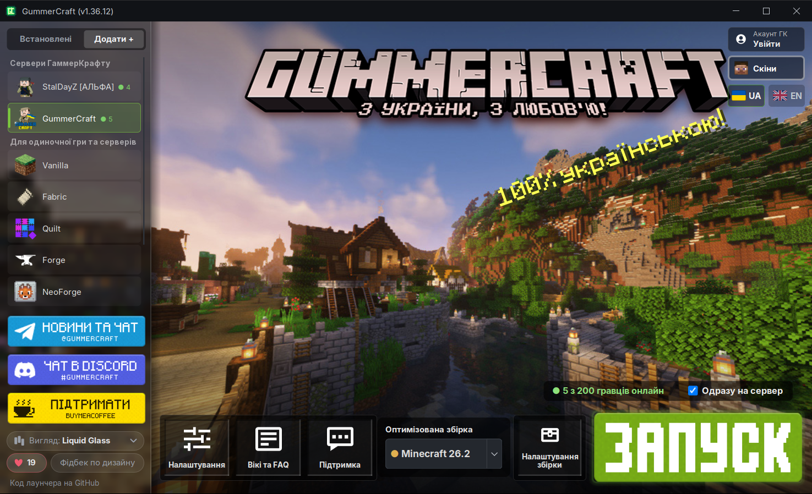
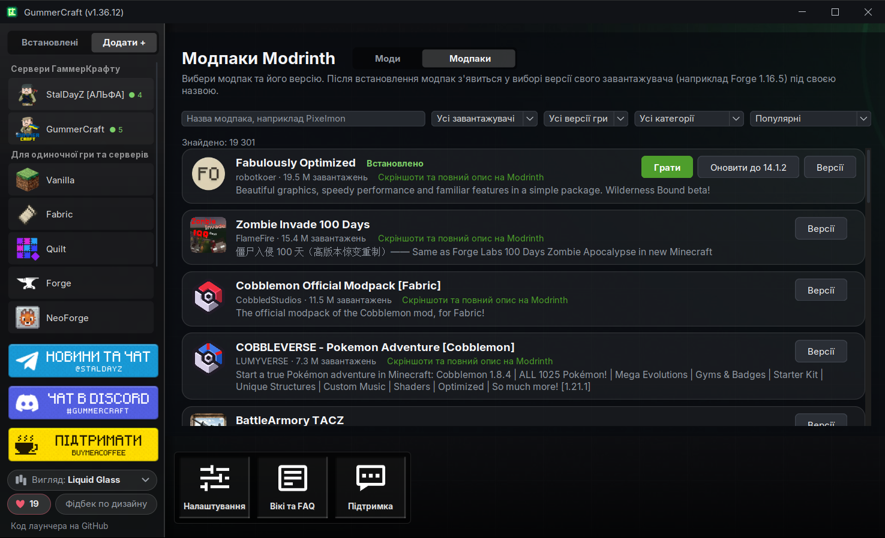
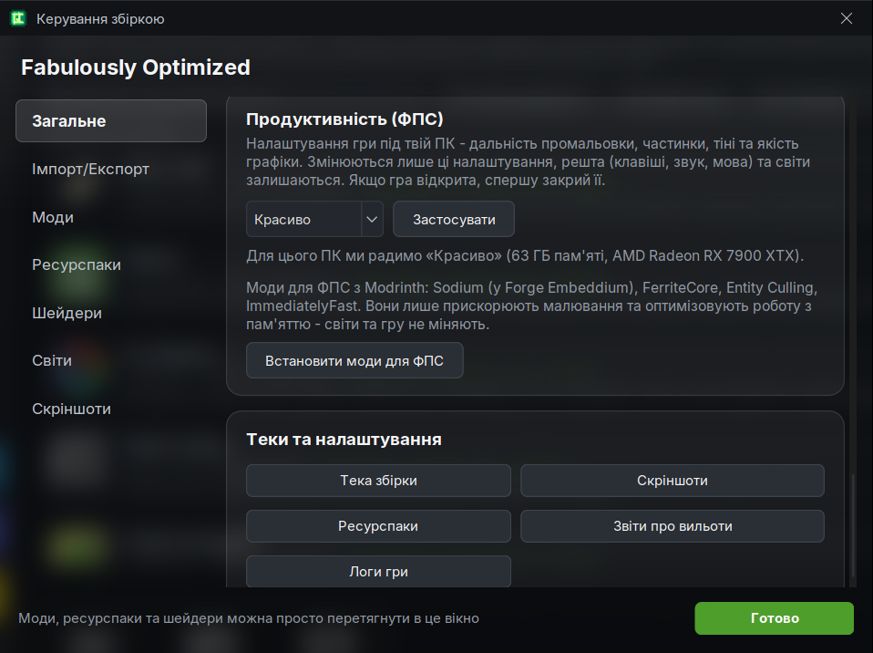
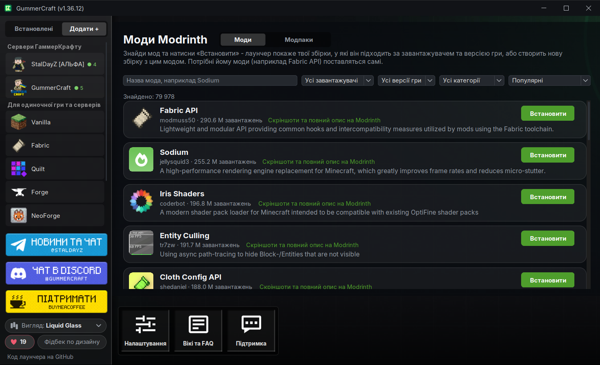
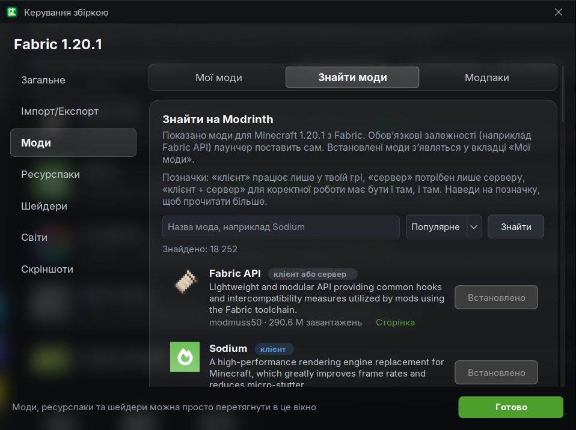
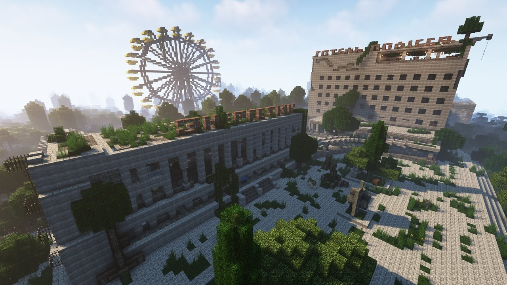

<div align="center">


</div>

# GummerCraft Launcher

<div align="center">

**[English](README.md)** · **Українська**

</div>

<div align="center">

[](https://gummercraft.fun/launcher)
[](LICENSE.txt)
[](https://gummercraft.fun/launcher)
[](https://gummercraft.fun/launcher)

</div>

Український лаунчер Minecraft з відкритим кодом (LGPL-3.0) від проєкту [GummerCraft](https://gummercraft.fun): безкоштовний, без реклами, для Windows, Linux, Steam Deck та macOS. Ставить будь-яку версію Minecraft, Fabric, Quilt, Forge і NeoForge, модпаки та моди з Modrinth, а також збірки наших серверів StalDayZ і GummerCraft. Інтерфейс українською та англійською.

**[Завантажити для Windows](https://launch.gummercraft.fun/install/GummerCraft.exe)** (один файл, Java вже всередині) · [портативний zip](https://launch.gummercraft.fun/install/GummerCraft-portable.zip) · [Linux і Steam Deck](https://launch.gummercraft.fun/install/linux/GummerCraft-Linux.desktop) · [jar для macOS і Linux](https://launch.gummercraft.fun/install/jar) · [сторінка лаунчера](https://gummercraft.fun/launcher)

*English version of this page: [README.md](README.md).*

| Головне вікно (Liquid Glass) | Модпаки Modrinth | Вікно «Збірка»: пресети ФПС |
|---|---|---|
|  |  |  |

| Моди Modrinth | Вікно «Збірка»: знайти моди |
|---|---|
|  |  |

## Можливості

**Версії гри та завантажувачі**
- Усі релізи Minecraft від Mojang, снапшоти та пре-релізи наступної версії, а також «музей» найстаріших версій: Classic, Infdev, Alpha, Beta аж до rd-132211.
- Fabric (з 1.14), Quilt, Forge (з 1.7.10) і NeoForge (з 1.20.2): лаунчер сам ставить завантажувач, Forge і NeoForge готує сам, як офіційний установник. Версію завантажувача можна змінити.
- Потрібну Java (8, 11, 16, 17, 21 або 25, збірки Eclipse Temurin) лаунчер ставить сам під кожну версію гри. У налаштуваннях видно, чи є новіша Java, з кнопками «Оновити» та «Відкатити».
- Скільки завгодно установок однієї версії, копії збірок в один клік, своя назва, іконка та фон у кожної збірки.

**Modrinth, моди та модпаки**
- Модпаки Modrinth одним кліком, з пошуком і фільтрами. Оновлення модпаків зі списком змін від авторів і поверненням на попередню версію.
- Пошук і встановлення модів, ресурспаків і шейдерів прямо у вікні «Збірка». Потрібні залежності ставляться самі, кожен файл звіряється з хешем Modrinth, біля мода видно, чи він клієнтський, серверний чи потрібен і там, і там.
- Оновлення своїх модів по одному або кнопкою «Оновити все», з Modrinth і CurseForge. Стара версія мода зберігається 30 днів: якщо після оновлення гра почала вилітати, мод повертається однією кнопкою.
- Модпаки CurseForge: пошук і встановлення на сторінці «CurseForge», як Modrinth, або відкрити zip-збірку CurseForge. `.mrpack` Modrinth теж. Моди, які автори дозволяють качати лише з сайту CurseForge, показуються списком з кнопкою «Скачати», а скачані файли лаунчер сам забирає з теки «Завантаження».
- «Поділитися збіркою»: файл `.mrpack` на кілька кілобайт, де моди з Modrinth і CurseForge записані посиланнями, або `.zip` з усіма модами. Обидва відкриє наш лаунчер, Prism теж (моди з CurseForge з `.mrpack` він пропустить).
- Імпорт збірок з Prism Launcher, PolyMC, ATLauncher, CurseForge, старого Modrinth App, TLauncher, SKlauncher та офіційного лаунчера Minecraft (MultiMC і будь-який інший лаунчер: тека вручну). Моди, налаштування, ресурспаки та шейдери переносяться, світи за бажанням.
- Набори модів одним кліком (зручність, мапа, шейдери, атмосфера), підібрані під завантажувач і версію гри збірки.
- Гра з другом: лаунчер сам ставить і налаштовує мод для гри поруч чи через інтернет без відкриття портів, навіть з другом без ліцензії.

**Помічник: коли щось пішло не так**
- **Перед запуском** перевіряє моди: мод не під той завантажувач чи не під ту версію гри, той самий мод двічі, несумісні пари, брак залежностей. Пропонує знайти на Modrinth правильну версію, докачати залежність або вимкнути зайве. Пошкоджені чи відсутні файли гри докачує сам.
- **Після вильоту** розбирає журнал гри і пояснює причину звичайними словами: мод, що вбив гру, брак пам'яті, драйвер відеокарти, не та Java чи її параметри, зламаний конфіг мода, пошкоджений світ, кирилиця в шляху, файл, заблокований антивірусом. Поруч кнопки виправлення: вимкнути мод, докачати потрібний, скинути конфіг, повернути попередню версію мода.
- Підтримка прямо з лаунчера: звернення стає чатом з нашою командою, лог і дані системи додаються самі (за галочкою).

**Продуктивність**
- Пресети ФПС «Слабкий ПК», «Збалансовано», «Красиво» з порадою під пам'ять і відеокарту ПК та модами для ФПС з Modrinth (Sodium або Embeddium, FerriteCore, Entity Culling, ImmediatelyFast). Кнопка «Повернути налаштування гри» скасовує пресет.
- На ПК з двома відеокартами гра за замовчуванням іде на дискретній, у збірці можна вибрати іншу. Пам'ять і Java для кожної збірки окремо, з порадою за кількістю модів і налаштованим збирачем пам'яті для Minecraft 1.18+.
- Перевірка місця на диску перед завантаженням. Перша установка гри кількома великими архівами з нашого CDN, що докачуються після обриву.

**Акаунти та інтерфейс**
- Вхід через Microsoft або локальний акаунт з будь-яким ніком. Встановлені збірки запускаються і без інтернету.
- Необов'язковий акаунт GummerCraft: скіни для наших серверів і кабінет зі статистикою гравця.
- Три вигляди: Liquid Glass, Класика та Бібліотека. Мова UA або EN перемикається прапорцем без перезапуску.

**Платформи**
- Windows 7-11: один `GummerCraft.exe` з Java всередині (17 на Windows 10 і 11, 8 на Windows 7 і 8.1), без прав адміністратора. Для Windows 10 і 11 є ще портативний zip.
- Linux x86_64 і Steam Deck: файл `GummerCraft-Linux.desktop` ставить лаунчер з власною Java без терміналу і прав root, додає його в меню програм, а на SteamOS ще і в бібліотеку Steam з обкладинками GummerCraft (кавер, шапка, логотип; свої обкладинки гравця не чіпає), щоб запускати з ігрового режиму. З 1.36.8 ще і з розкладкою геймпада, якою грається і в лаунчері, і в грі (таблиця кнопок у [tools/linux](tools/linux/README.md)). Інструкція і скрипт: [tools/linux](tools/linux).
- macOS: jar-файл, потрібна встановлена Java 8 або новіша.
- На Linux і macOS лаунчер сам вмикає полегшений режим без розмиття та анімацій.
- Лаунчер оновлюється сам: нова версія качається по HTTPS і звіряється з SHA-256.

## StalDayZ і GummerCraft

<div align="center">



</div>

**[StalDayZ](https://staldayz.gummercraft.fun/)** - наш сервер за мотивами S.T.A.L.K.E.R. і DayZ у Minecraft: Зона відчуження, лутінг, аномалії та артефакти, викиди, радіація, мутанти, квести, торгівля та бази гравців. Також у лаунчері є збірки GummerCraft для різних версій Minecraft.

Зайти на сервер можна прямо з лаунчера: вибираєш збірку, натискаєш «Запуск», а всі потрібні моди лаунчер завантажить і оновлюватиме сам. Біля збірки видно онлайн сервера, а галочка «Одразу на сервер» запускає гру одразу з входом на сервер.

## Що нового в 1.41.6

- **Java ставиться, навіть коли антивірус блокує теку з ліцензіями.** Тексти ліцензій у теці Java (Java їх не читає) при помилці пропускаються, тож Java ставиться, а не падає і в «Документах», і в `%LOCALAPPDATA%`.
- **Java сама переходить у запасну теку і ставиться з першого разу.** Якщо Windows чи антивірус блокує стару Java, лаунчер переносить її в `%LOCALAPPDATA%\GummerCraft\runtime` і сам повторює встановлення, без другого «Запуску».
- **Сервер просить пароль:** після «Часу очікування авторизації» чи неправильного пароля лаунчер пояснює `/login`, з кнопками «Я забув пароль» і «Інша проблема».
- **Нік:** пробіли довкола офлайн-ніка прибираються, а нік зі змішаних латиниці та кирилиці не зареєструвати.

**Також у 1.41.5:** помічник вильотів називає мод, навіть коли звіт мовчить; «Мод A не сумісний з версією мода B» з кнопкою на стабільну чи попередню B; «Вимкнути» разом з тими, кому мод потрібен; Java в `%LOCALAPPDATA%\GummerCraft\runtime`, коли Windows стереже «Документи»; «Грати з другом» і у ванільних збірках.

**Також у 1.41.4:** мод ставиться з бета-версії, якщо жодна стабільна не йде під завантажувач збірки (JEI для Fabric 1.20.1); зрозумілі помилки на сторінці «Моди Modrinth»; «Шейдери» пишуть, що мод для шейдерів уже є.

**Також у 1.41.3:** Java ставиться, навіть коли антивірус блокує системні файли Windows (копії `ucrtbase.dll`, `api-ms-win-*.dll` на Windows 10 і 11 пропускаються).

**Також у 1.41.2:**

- **Гра з другом в один клік.** Правий клік по своїй збірці, «Гра з другом...», або наклейка «Грати з другом!» на головній. Скажи, чи друг поруч, і лаунчер сам поставить і налаштує потрібний мод: в одній мережі чи через інтернет без відкриття портів, навіть для друга без ліцензії, за бажанням з голосовим чатом. Далі короткі кроки в грі, кнопка «Передати збірку другу», а для гри поруч ще перевірка брандмауера Windows. Збірки, де такий мод уже стоїть, позначені синім значком з двома людьми.
- **Набори модів.** «Керування збіркою», «Моди», «Набори модів»: «Зручність», «Мапа», «Шейдери» і «Атмосфера і звук». Лаунчер сам підбирає моди під завантажувач і версію гри збірки і ставить усе одним кліком, «Прибрати набір» прибирає лише поставлене. Там же кнопка «Видалити моди мультиплеєра».
- **«Встановити мод для шейдерів»:** одна кнопка ставить Iris і Sodium або Oculus і Embeddium, коли в збірці немає мода для шейдерів.
- **Вибір версії мода:** кнопка «Версія...» поруч з «Встановити», а перед запуском лаунчер може сам знайти версії двох несумісних модів, з якими вони працюють разом.
- **CurseForge запасним джерелом** для модів на ФПС, наборів модів, «Гри з другом» і сумісних версій, коли на Modrinth нічого немає під збірку.
- **Ще:** звичайне вікно вибору файлів Windows з ескізами, шестерня і кнопка «Гра з другом» на плитках «Робочого столу», галочка «Грати з другом» у вікні вибору акаунта перед запуском.

**Також у 1.41.1:**

- **Моди під версію завантажувача.** Оновлення, встановлення і автовиправлення перед запуском більше не ставлять версію мода, якій потрібен новіший завантажувач, ніж у збірці; вікно вильоту оновлює завантажувач одним кліком.
- **Автовиправлення без зациклення** і з відкатом, «Є оновлення» у «Моїх модах», точніший розбір вильотів на ранньому екрані Forge і коли Windows не дає записувати файли.

Повний список змін у [CHANGELOG](CHANGELOG.md).

## Безпека та прозорість

- Що лаунчер робить у мережі (кожна адреса і що туди йде), що зберігає на комп'ютері та відомі обмеження: [SECURITY.md](SECURITY.md).
- Реклами немає. Є анонімна статистика: випадковий ID установки (ні з чого не виводиться, без ніка і акаунта), події «гру запущено» з назвою збірки, «завантаження збірки» та кілька інших, кожна описана в SECURITY.md. Слово `off` у файлі `stats-id.txt` у теці лаунчера вимикає все це.
- Офіційну збірку на CDN можна перевірити самому: дивись [«Перевірка офіційної збірки»](#перевірка-офіційної-збірки).
- SHA-256 файлів кожної версії опубліковано в [Releases](https://github.com/gummerBurt/GummerCraftLauncher/releases). Перевірити завантажений файл: `Get-FileHash GummerCraft.exe` у PowerShell або `sha256sum GummerCraft.exe` на Linux і macOS.

## Походження та ліцензія

Проєкт є форком **SKCraft Launcher** (Albert Pham / sk89q та контриб'ютори) і розповсюджується на тих самих умовах - **GNU LGPL v3**, повний текст у [LICENSE.txt](LICENSE.txt); на внески сторонніх авторів додатково діє BSD-ліцензія SKCraft, [licenses/BSD-contributors.txt](licenses/BSD-contributors.txt) (до 21.11.2026 вона була в кінці LICENSE.txt). Історія оригінального проєкту - в [репозиторії SKCraft](https://github.com/SKCraft/Launcher).

Зміни команди GummerCraft (2021-2026): новий інтерфейс на FlatLaf (`launcher-flat`, три вигляди), українська та англійська локалізація, власні маніфести збірок і Java-рантаймів, розділи Vanilla, Fabric, Quilt, Forge, NeoForge, інтеграція з Modrinth, керування збірками і модами, помічник при запуску і вильоті, підтримка в лаунчері, імпорт з інших лаунчерів, установка на Linux і Steam Deck. Повна історія в [CHANGELOG.md](CHANGELOG.md). Файли, додані командою, лежать у пакетах `com.gummer.*` і мають заголовок `Copyright (C) GummerCraft`; змінені файли SKCraft мають обидва копірайти.

## Що лаунчер робить на комп'ютері

- Усі файли - **в одній папці** `GummerCraft` у теці, яку Java вважає документами: `Документи\GummerCraft` на Windows, `~/GummerCraft` на Linux (там же ставить і установка для Linux та Steam Deck). Шлях зберігається в `GummerCraft/bootstrap.yml` і його можна змінити. Портативний режим - файл `portable.txt` поруч із лаунчером.
- Вміст папки: `launcher/` (jar лаунчера), `runtime/` (портативна Java - збірки Eclipse Temurin), `assets/`, `libraries/`, `versions/` (файли Minecraft), `instances/` (збірки), `config.json` (налаштування), `accounts.dat` (збережені акаунти), з 1.32 `support.json` (звернення в підтримку з лаунчера), `launcher-ui.json` (вкладка, остання збірка, «Одразу на сервер»), `logs/launcher.log` (журнал лаунчера за останні три запуски), `news-cache.json` і `vanilla_versions.json` (копії новин і списку версій Mojang), `stats-id.txt` (анонімний випадковий ID установки для підрахунку гравців, нічого про вас не містить; `off` у файлі вимикає, деталі в [SECURITY.md](SECURITY.md)). Ванільні версії з вкладки Vanilla ставляться в `instances/vanilla-<версія>`. З 1.33 розділи завантажувачів ставляться в `instances/fabric-<версія>`, `quilt-<версія>`, `forge-<версія>`, `neoforge-<версія>` (вибрана версія завантажувача у файлі `fabric-loader.txt` і подібних у теці паку), списки версій зберігаються в `fabric_games.json`, `fabric_loaders.json`, `quilt_games.json`, `quilt_loaders.json`, `forge_versions.xml`, `forge_promotions.json`, `neoforge_versions.xml`, офіційні установники Forge і NeoForge в `loaders/`. Токен і нік аккаунта на ГаммерКрафті (якщо гравець увійшов) у `launcher-ui.json`, пароль ніде. З 1.32 може з'явитись `launcher/ui-scale.txt`: зменшений масштаб інтерфейсу, якщо вікно лаунчера з масштабом Windows не влазить в екран (видалення файлу нічого не ламає).
- З 1.32 для нових гравців є один файл `GummerCraft.exe` з вбудованою Java (Eclipse Temurin JRE 17 на Windows 10+, JRE 8 на Windows 7/8.1). При першому запуску він кілька секунд розпаковує лаунчер і Java в `%LOCALAPPDATA%\GummerCraft\app` (без прав адміністратора), далі одразу відкриває лаунчер. Ярликів, записів у «Програми та компоненти» і змін у реєстрі він не робить; щоб прибрати, досить видалити цю папку або з 1.36.3 натиснути в налаштуваннях лаунчера «Видалити лаунчер та всі збірки». Пункт нижче стосується самого лаунчера.
- Лаунчер **не пише в реєстр**, з одним винятком: вибір відеокарти для збірки (з 1.36.3; вікно «Збірка», видно лише на ПК з двома відеокартами: «Як вирішить система», «назва (інтегрована)», «назва (дискретна)»). З 1.36.11 за замовчуванням дискретна: перед кожним запуском лаунчер заново читає список відеокарт, і якщо їх дві (вбудована та окрема), записує одне значення в `HKCU\Software\Microsoft\DirectX\UserGpuPreferences`: назва це шлях до Java, яку поставив сам лаунчер, вміст `GpuPreference=1;` («Енергозбереження», інтегрована) або `GpuPreference=2;` («Висока продуктивність», дискретна). Рівно це записує і сторінка Windows «Параметри графіки», і запис видно там же. Системну Java та вибір, уже зроблений гравцем у Windows, лаунчер не чіпає; повернути «Як вирішить система», видалити збірки або лишитись з однією відеокартою означає прибрати запис. Кожна дія йде в лог лаунчера, а список записаного лежить у `gpu-prefs.txt` у його папці. На Linux для дискретної лаунчер лише додає грі змінні PRIME (`DRI_PRIME` або PRIME offload NVIDIA) на цей запуск, на macOS вибору немає. Крім цього лаунчер лише читає ключі встановленої Java, щоб її знайти, і з 1.36 назви відеокарт (для поради пресета ФПС і для цього вибору; назви нікуди не надсилаються), **не додає себе в автозапуск**, не створює служб, задач планувальника чи ярликів і не змінює файли поза своєю папкою.
- З 1.36.3 у налаштуваннях («Додатково», «Видалення») є «Видалити всі збірки» і «Видалити лаунчер та всі збірки». Друга кнопка прибирає свою папку даних, `%LOCALAPPDATA%\GummerCraft\app` і `bootstrap.yml` у Документах. Видаляється лише те, що створив лаунчер, за списком назв: чужі файли в папці даних лишаються.
- Єдиний процес, який він запускає, - сама гра.

Детально про мережеві з'єднання, акаунти та відомі обмеження - у [SECURITY.md](SECURITY.md).

## Збірка

Потрібен **JDK 8** (збірка з іншою версією Java зупиниться з помилкою).

1. Скопіюйте `gradle.properties.example` у `gradle.properties` (файл у `.gitignore`).
2. Впишіть у нього `microsoftClientId` - ID власного застосунку Azure для входу через Microsoft ([реєстрація застосунку](https://learn.microsoft.com/entra/identity-platform/quickstart-register-app), тип «Personal Microsoft accounts», redirect `http://localhost`; для доступу до API Minecraft Microsoft вимагає окремо подати застосунок на схвалення). Без цього збірка зупиниться з помилкою. Офіційний ID GummerCraft у репозиторій не входить.
3. Якщо `JAVA_HOME` вказує не на JDK 8, пропишіть там же `org.gradle.java.home`.

```bash
./gradlew clean build
```

Або `build.bat` (Windows) / `build.sh` (Linux, macOS).

Готові файли - у `<модуль>/build/libs`. Exe-обгортка бутстрапера (Launch4j):

```bash
./gradlew clean build createAllExecutables
```

Результат - `launcher-bootstrap/build/launch4j/Gummer_Craft_launcher.exe`. З 1.36.15 офіційні релізи підписані сертифікатом підпису коду Certum (видавець «Open Source Developer, Mykola Netreba», ключ у хмарі Certum SimplySign, не в репозиторії); підписує `tools/installer/sign.py`. Власна збірка без підпису.

## Перевірка офіційної збірки

Офіційний лаунчер на CDN збирається з цього ж коду. Перевірити це може будь-хто:

```bash
./gradlew clean build
python tools/verify-cdn.py
```

Скрипт (лише Python 3, без сторонніх пакетів) бере адресу і SHA-256 поточної версії з `cdn.gummer.cc/launcher/install/release.json`, завантажує офіційний jar, звіряє хеш і порівнює вміст з вашою збіркою файл за файлом. Відрізнятися має лише `launcher.properties`: ID застосунку Microsoft (у репозиторій не входить) і дані збірки (`commit`, `branch`). Офіційний jar містить коміт цього репозиторію, з якого його зібрано; якщо ваша збірка з іншого коміту, скрипт підкаже, який зробити `git checkout`. Хеш jar цілком не збігатиметься ніколи - у zip записані дати файлів, тому порівнюється вміст.

## Модулі

| Модуль | Призначення |
|---|---|
| `launcher-bootstrap` | бутстрапер (exe/jar): знаходить робочу папку, завантажує і оновлює jar лаунчера |
| `launcher` | ядро: акаунти, встановлення збірок, запуск гри |
| `launcher-flat` | інтерфейс GummerCraft (FlatLaf) |
| `launcher-shared` | спільний код бутстрапера і лаунчера |
| `launcher-builder` | утиліта збирання маніфестів збірок для CDN |
| `creator-tools` | графічний редактор збірок (з SKCraft) |
| `launcher-fancy` | старий інтерфейс SKCraft, вимкнений у `settings.gradle` |

## Сторонній код

Окрім залежностей, які підтягує Gradle (FlatLaf, Guava, Jackson тощо - кожна під своєю ліцензією), у репозиторії є скопійовані файли з інших проєктів; їхні оригінальні шапки з копірайтом і ліцензією збережені у файлах:

| Файли | Джерело | Ліцензія |
|---|---|---|
| `launcher/.../util/FlatClientProperties.java`, `FlatSystemProperties.java` | [FlatLaf](https://github.com/JFormDesigner/FlatLaf), FormDev Software GmbH | Apache 2.0 ([licenses/Apache-2.0.txt](licenses/Apache-2.0.txt)) |
| `launcher-flat/src/main/resources/com/gummer/launcher/fonts/Inter-*.ttf` | [Inter](https://github.com/rsms/inter) 4.0, The Inter Project Authors (з `flatlaf-fonts-inter`, перегнано з OTF у TrueType скриптом `tools/inter-otf2ttf.py`, з 1.36.6) | SIL Open Font License 1.1 ([Inter-LICENSE.txt](launcher-flat/src/main/resources/com/gummer/launcher/fonts/Inter-LICENSE.txt)) |
| `launcher/.../popup/GraphicsUtilities.java`, `ShadowRenderer.java` | [SwingX](https://github.com/ebourg/swingx), Sun Microsystems / Romain Guy | LGPL 2.1+ (GraphicsUtilities - також BSD) |
| `launcher-shared/.../tls/extra-roots.pem` | кореневі сертифікати з `cacerts` Eclipse Temurin (програма CA Mozilla) | публічні сертифікати CA |

## Нотатки для розробників

- Переклади лаунчера: `launcher/src/main/resources/com/gummer/launcher/lang/Launcher_uk_ua.properties` і `Launcher_en_us.properties`; бутстрапера - `launcher-bootstrap/src/main/resources/com/skcraft/launcher/lang/Bootstrap.properties`.
- Головне вікно у трьох виглядах: `launcher-flat/src/main/java/com/gummer/launcher/dialog/LauncherFrameFlat.java` (Liquid Glass), `LauncherFrameFlat2.java` (Класика), `LauncherFrameFlat3.java` (Бібліотека); фон і логотип збірки - `FlatBackgroundPanel*.java`; кольори та форми кожного вигляду - `look/LookTheme.java`; вікно «Збірка» - `dialog/InstanceManageDialog.java`. Іконки та формати - `launcher/src/main/resources/com/skcraft/launcher`.
- Помічник: перевірка перед запуском - `launcher/.../manage/PreLaunchCheck.java`, розбір вильотів - `launcher/.../crash/CrashAnalyzer.java`; Modrinth - `launcher/.../manage/ModrinthBrowse.java` і пакет `modrinth`.
- Фон вікна: `launcher/src/main/resources/com/skcraft/launcher/ui/frame/bg.jpg` (1276x718). Власний фон збірки - `bg_<назва збірки>.jpg` поруч (назва з маніфесту, малими літерами, наприклад `bg_staldayz.jpg`, 1276x718, малюється по центру), власний логотип - `logo_<назва збірки>.png` (PNG з прозорістю, вписується без розтягування в зону стандартного logo.png 724x180). Показуються, коли збірку вибрано в списку (`FlatBackgroundPanel.showPack`). Зсуви фону і логотипа збірки (у пікселях) і власні адреси кнопок - `frame_<назва збірки>.properties` поруч: `background.x/y`, `logo.x/y`, `wiki.url`, `telegram.url`, `discord.url`. Картинки кнопок Telegram/Discord зі своєю назвою каналу - `ui/button/telegram_<мова>_<назва збірки>.png` (і `discord_...`).
- Адреси CDN, новин і самооновлення: `launcher/src/main/resources/com/skcraft/launcher/launcher.properties` та `launcher-bootstrap/src/main/resources/com/skcraft/launcher/bootstrap.properties`.
- Шрифт інтерфейсу - Inter (вбудований, див. «Сторонній код»); нікнейм локального акаунта 3-16 символів.
- Налагодження Java-рантаймів: `launcher/src/main/java/com/skcraft/launcher/update/Updater.java`.

